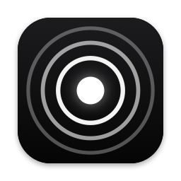
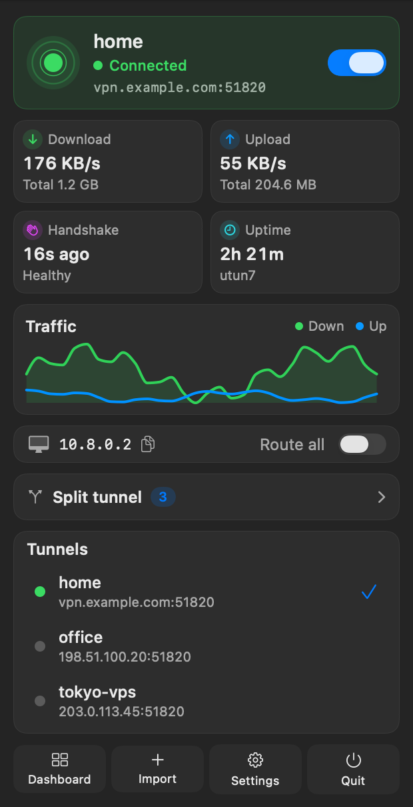
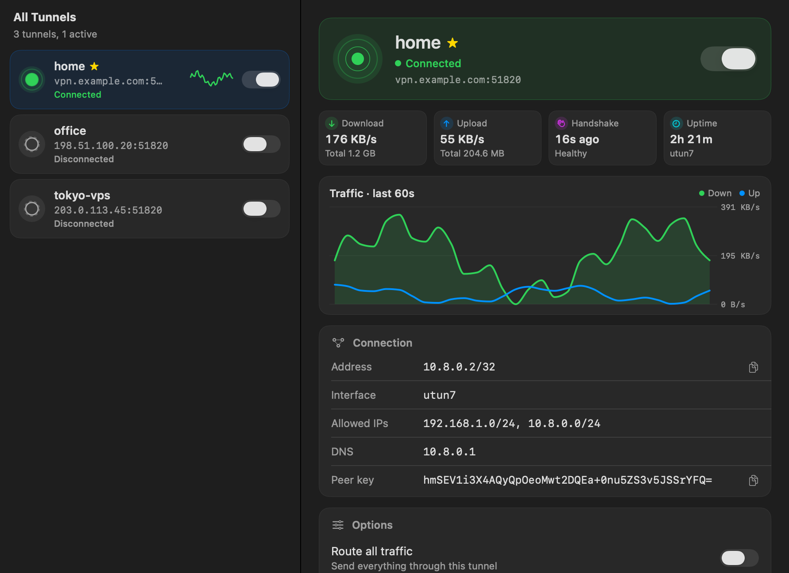

<p align="center">
  
</p>

<h1 align="center">Wirelight</h1>

<p align="center">
  A friendly menu bar client for WireGuard® tunnels on macOS.<br>
  Works with a free Apple developer account. No Network Extension needed.
</p>

<p align="center">
  <a href="https://github.com/boatngin/wirelight/releases/latest"></a>
  <a href="https://github.com/boatngin/wirelight/actions/workflows/ci.yml"></a>
  <a href="LICENSE"></a>
  
</p>

<p align="center">
  <a href="https://github.com/boatngin/wirelight/releases/latest/download/Wirelight.pkg"><b>Download for macOS</b></a> ·
  <a href="https://boatngin.github.io/wirelight/">Website</a> ·
  <a href="https://github.com/boatngin/wirelight/discussions">Discussions</a> ·
  <a href="README.th.md">ภาษาไทย</a>
</p>

---

<p align="center">
  
  &nbsp;&nbsp;
  
</p>

## Features

- **Menu bar dashboard**: connect with one switch and watch live download and upload, handshake age, uptime and a 60-second traffic chart.
- **Dashboard window**: every tunnel, its details, import, settings and the event log in one place.
- **Split DNS**: send only some domains (like `lan` or `corp.example`) to the tunnel's DNS.
- **Split tunnel exclusions**: keep chosen CIDRs off the tunnel, even when routing all traffic.
- **Route all traffic**: full-tunnel mode in one click.
- **Stays connected**: re-resolves endpoints after sleep and network changes, and warns when the handshake goes stale.
- **Safe by design**: keys stay in your Keychain, and the root helper rejects scripting hooks and runs only allow-listed tools. See [SECURITY.md](SECURITY.md).

## Install

### 1. Install the WireGuard tools

Wirelight uses the official userspace tools. The Homebrew cask in step 2 installs them for you; to install them manually, use [Homebrew](https://brew.sh):

```bash
brew install wireguard-tools wireguard-go
```

### 2. Install Wirelight

With [Homebrew](https://brew.sh):

```bash
brew tap boatngin/tap
brew install --cask wirelight
```

Or manually:

1. Download **[Wirelight.pkg](https://github.com/boatngin/wirelight/releases/latest/download/Wirelight.pkg)** from the [latest release](https://github.com/boatngin/wirelight/releases/latest).
2. Open it and follow the installer. It installs:
   - `Wirelight.app` in `/Applications`
   - the helper daemon `/Library/PrivilegedHelperTools/wgbar-helper` (LaunchDaemon `com.thanaboat.wgbar.helper`)
   - the CLI `/usr/local/bin/wgbarctl`

> [!NOTE]
> Builds aren't notarized yet. If macOS blocks the installer, right-click it and choose **Open**, or click **Open Anyway** in **System Settings › Privacy & Security**.
> You can verify the download first: `shasum -a 256 -c Wirelight-<version>.pkg.sha256`

### 3. Add a tunnel

1. Open **Wirelight**. The ping icon appears in the menu bar.
2. Choose **Import** and drop in a `.conf` file, for example one exported from OPNsense, pfSense or your VPS.
3. Flip the switch.

When macOS asks for Keychain access, choose **Always Allow** so it won't ask again.

### Check your setup

```bash
wgbarctl doctor
```

### Uninstall

Disconnect all tunnels, then run:

```bash
sudo /usr/local/share/wirelight/uninstall.sh
```

Your configs stay in the login Keychain (service `com.thanaboat.wgbar`). Delete them in Keychain Access if you want.

## Using it

| Menu bar icon | Meaning |
|---|---|
| Hollow centre with a faint dashed ring | Disconnected |
| Rings pulsing outward | Connecting or disconnecting |
| Solid centre with two steady rings | Connected |
| Hollow centre with steady rings | Connected, but no handshake for over 3 minutes |

- Only one tunnel is active at a time. Switching tunnels disconnects the current one first.
- Quitting the app leaves the tunnel up on purpose. Reopen the app and it picks up the current state.
- Scripting hooks (`PreUp`, `PostUp`, `PreDown`, `PostDown`) aren't supported. Configs that use them are rejected.

### Command line

```bash
wgbarctl ping
```
```bash
wgbarctl status
```
```bash
wgbarctl up <name> <file.conf>
```
```bash
wgbarctl down <name>
```
```bash
wgbarctl refresh
```
```bash
wgbarctl doctor
```

## Troubleshooting

| Problem | Fix |
|---|---|
| "Helper not running" banner | Reinstall the package, or run `sudo launchctl kickstart -k system/com.thanaboat.wgbar.helper` |
| No handshake | Check the endpoint, port forwarding and firewall on the server. Test the same file with `sudo wg-quick up file.conf` to rule out the app. |
| DNS not restored | The helper saves your original DNS in `/Library/Application Support/WGBar/state/` and restores it on its next start |
| Conflicts with `wg-quick` | Run `wg-quick down` before using Wirelight |

Watch the helper log live:

```bash
log stream --predicate 'subsystem == "com.thanaboat.wgbar"'
```

## How it works

```
Wirelight.app (SwiftUI menu bar)  ──JSON over Unix socket──▶  wgbar-helper (root LaunchDaemon)
                                     /var/run/wgbar.sock         ├─ wireguard-go   creates utun
                                                                 ├─ wg setconf     keys and peers
                                                                 ├─ ifconfig/route addresses and routes
                                                                 ├─ networksetup   DNS (restored on disconnect)
                                                                 └─ /etc/resolver  split DNS
```

Wirelight uses a small root helper instead of a Network Extension, so it runs without a paid Apple Developer Program membership.

## Roadmap

Planned work lives in [issues](https://github.com/boatngin/wirelight/issues). Highlights:

- [ ] [Kill switch](https://github.com/boatngin/wirelight/issues/4)
- [ ] [On-demand rules by Wi-Fi network](https://github.com/boatngin/wirelight/issues/5)
- [x] [Homebrew cask](https://github.com/boatngin/wirelight/issues/10)
- [ ] [Notarized releases](https://github.com/boatngin/wirelight/issues/11)
- [x] [Global hotkey](https://github.com/boatngin/wirelight/issues/8)

Got an idea? Share it in [Discussions › Ideas](https://github.com/boatngin/wirelight/discussions/categories/ideas).

## Development

### Requirements

- macOS 13 or later, Xcode 15 or later
- `brew install wireguard-tools wireguard-go xcodegen`

### Layout

| Path | What |
|---|---|
| `Sources/WGCore` | Config parser, validation, IPC models, socket client (shared) |
| `Sources/wgbar-helper` | Root helper daemon |
| `Sources/wgbarctl` | CLI |
| `Tests/WGCoreTests` | Unit tests |
| `App/` | SwiftUI app (XcodeGen `project.yml`) |
| `installer/`, `scripts/` | Package installer, helper install scripts, icon generator |

### Build and test

```bash
swift build && swift test
```

Run the app:

```bash
cd App && xcodegen generate && open Wirelight.xcodeproj
```

The app is signed ad-hoc by default. To sign with your own Apple Development identity, so Keychain "Always Allow" survives rebuilds:

```bash
cp App/Config/Local.xcconfig.example App/Config/Local.xcconfig
```

Then set `DEVELOPMENT_TEAM` in `App/Config/Local.xcconfig`. That file is git-ignored.

Install the helper from source (it asks for your password):

```bash
./scripts/install-helper.sh
```

Build the installer package:

```bash
./scripts/build-pkg.sh 0.1.0
```

Regenerate the app icon:

```bash
swift scripts/make-icons.swift .
```

### Contributing

Read [CONTRIBUTING.md](CONTRIBUTING.md). Issues labelled [good first issue](https://github.com/boatngin/wirelight/labels/good%20first%20issue) are a great place to start.

## Support the project

If Wirelight is useful to you:

- ⭐ Star the repo so more people can find it
- 🗣️ Tell a friend, or share it on your favourite Mac or homelab community
- 🐛 Report bugs and 💡 suggest features
- 🛠️ Pick up a [good first issue](https://github.com/boatngin/wirelight/labels/good%20first%20issue)

<a href="https://star-history.com/#boatngin/wirelight&Date"></a>

## License

[MIT](LICENSE). See [NOTICE.md](NOTICE.md) for trademarks and third-party software.

"WireGuard" is a registered trademark of Jason A. Donenfeld. Wirelight is not affiliated with or endorsed by the WireGuard project.
