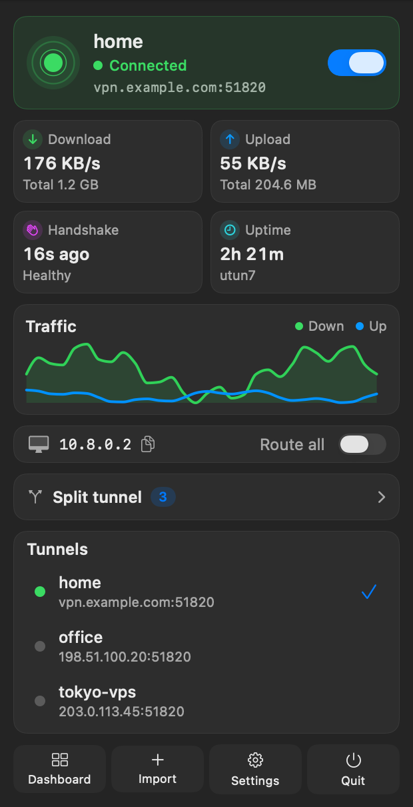
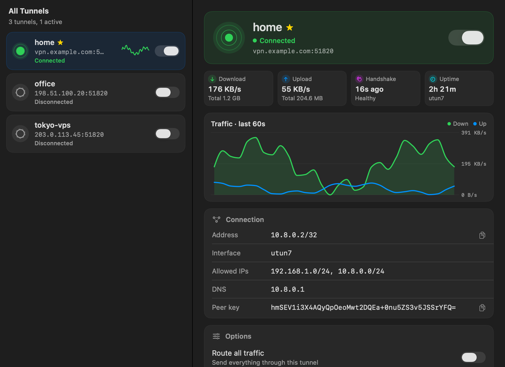

# Wirelight

แอป menu bar บน macOS สำหรับต่อ WireGuard® ใช้ได้กับบัญชี Apple Developer แบบฟรี ไม่ต้องใช้ Network Extension

[English](README.md)

<p align="center">
  
  &nbsp;&nbsp;
  
</p>

## ความสามารถ

- **Dashboard บน menu bar**: เปิดปิด tunnel ได้ด้วยสวิตช์เดียว ดูความเร็ว ↓↑, handshake, uptime และกราฟ traffic 60 วินาทีได้สด ๆ
- **หน้าต่าง Dashboard**: รวม tunnel ทั้งหมด รายละเอียด, Import, Settings และ Log ไว้ที่เดียว
- **Split DNS**: ใช้ DNS ของ tunnel เฉพาะ domain ที่กำหนด เช่น `lan`
- **Split tunnel exclusions**: CIDR ที่กำหนดไม่ต้องผ่าน tunnel แม้เปิด Route all traffic อยู่
- **แจ้งเตือนเมื่อมีปัญหา**: บอก "No answer from server" ภายใน 25 วินาที, เชื่อมต่อไม่สำเร็จมีปุ่ม Retry, เตือน IPv6 รั่วพร้อมปุ่ม Block IPv6 และต่อใหม่เองเมื่อ tunnel หลุด
- **วัดคุณภาพลิงก์** (เปิดเองได้): latency, packet loss และเกรด Good / Fair / Poor พร้อมกราฟ และ speed test กับไฟล์ HTTPS ของคุณเอง
- **หน้า Heads-up**: รวมปัญหาทั้งหมดพร้อมวิธีแก้ และ Log ค้นหา กรอง คัดลอก ล้างได้
- **ปรับหน้าตา**: ไอคอน menu bar แบบขาวดำหรือมีสีตามสถานะ และ pill แสดงสถานะข้างรอยบากจอ
- **กฎตามเครือข่าย**: แต่ละ tunnel ต่อหรือตัดเองตามชื่อ Wi-Fi, Wi-Fi ใดก็ได้, Ethernet ตาม subnet หรือ Ethernet ใดก็ได้ และกำหนดว่า "ที่อื่น ๆ" ให้ทำอะไร
- **Shortcuts และ Siri**: มี action Connect/Disconnect Tunnel, Disconnect All, Connect Favorites และ Get Connected Tunnels
- **Route all traffic**: ส่งทุกอย่างผ่าน tunnel ด้วยคลิกเดียว
- **เปิดหลาย tunnel พร้อมกัน**: บ้าน ที่ทำงาน และ lab เปิดคู่กันได้ แต่ละอันมีสวิตช์และความเร็วของตัวเอง (route all ได้ทีละอัน) มีปุ่ม Favorites on และ All off
- **ต่อเนื่อง**: resolve endpoint ใหม่หลังเครื่องตื่นจาก sleep หรือเปลี่ยนเครือข่าย และเตือนเมื่อ handshake หาย
- **ปลอดภัย**: private key เก็บใน Keychain ส่วน helper ไม่รับคำสั่ง hook และรันเฉพาะเครื่องมือที่อยู่ใน allowlist ดูรายละเอียดที่ [SECURITY.md](SECURITY.md)

## ติดตั้ง

1. ติดตั้งเครื่องมือ WireGuard:
   ```bash
   brew install wireguard-tools wireguard-go
   ```
2. ดาวน์โหลด **[Wirelight.pkg](https://github.com/boatngin/wirelight/releases/latest/download/Wirelight.pkg)** แล้วเปิดเพื่อติดตั้ง
   - ตอนนี้ไฟล์ยังไม่ได้ notarize ถ้า macOS บล็อก ให้คลิกขวาที่ไฟล์แล้วเลือก **Open** หรือไปที่ **System Settings › Privacy & Security** แล้วกด **Open Anyway**
3. เปิดแอป **Wirelight** แล้วเลือก **Import** และลากไฟล์ `.conf` มาวาง จากนั้นกดสวิตช์เพื่อเชื่อมต่อ
4. ถ้า macOS ถามสิทธิ์ Keychain ให้กด **Always Allow**

ตรวจการติดตั้งด้วย `wgbarctl doctor`

ถอนการติดตั้ง: ปิด tunnel ทุกตัวก่อน แล้วรัน:
```bash
sudo /usr/local/share/wirelight/uninstall.sh
```

## ไอคอนบน menu bar

| ไอคอน | สถานะ |
|---|---|
| วงกลางกลวง กับวงนอกเส้นประจาง | ไม่ได้เชื่อมต่อ |
| วงคลื่นขยายออกจากจุดกลาง | กำลังเชื่อมต่อ หรือกำลังตัดการเชื่อมต่อ |
| จุดกลางทึบ มีวงคลื่นนิ่ง 2 วง | เชื่อมต่ออยู่ |
| จุดกลางกลวง มีวงคลื่นนิ่ง | handshake หายไปนานเกิน 3 นาที |

## แก้ปัญหา

| อาการ | วิธีแก้ |
|---|---|
| แอปขึ้นแถบ "Helper not running" | ติดตั้ง pkg ใหม่ หรือรัน `sudo launchctl kickstart -k system/io.github.boatngin.wirelight.helper` |
| ไม่มี handshake | เช็ค endpoint, port forward และ firewall ฝั่ง server ลองรัน `sudo wg-quick up file.conf` เพื่อแยกว่าปัญหาอยู่ที่แอปหรือที่ config |
| DNS ไม่คืนค่าเดิม | helper เก็บค่าเดิมไว้ที่ `/Library/Application Support/WGBar/state/` และจะคืนค่าให้ตอน start รอบถัดไป |

ดู log ของ helper:
```bash
log stream --predicate 'subsystem == "io.github.boatngin.wirelight"'
```

## สำหรับนักพัฒนา

```bash
brew install wireguard-tools wireguard-go xcodegen
```
```bash
swift build && swift test
```
```bash
cd App && xcodegen generate && open Wirelight.xcodeproj
```

- ถ้าจะ sign ด้วยบัญชี Apple Development ของตัวเอง: copy `App/Config/Local.xcconfig.example` เป็น `App/Config/Local.xcconfig` แล้วใส่ Team ID (ไฟล์นี้ไม่ถูก commit)
- ติดตั้ง helper จาก source: `./scripts/install-helper.sh`
- สร้างไฟล์ติดตั้ง: `./scripts/build-pkg.sh 0.1.0`

อ่านวิธีร่วมพัฒนาที่ [CONTRIBUTING.md](CONTRIBUTING.md)

## License

[MIT](LICENSE) ดูเรื่องเครื่องหมายการค้าและซอฟต์แวร์ของบุคคลที่สามใน [NOTICE.md](NOTICE.md)

"WireGuard" เป็นเครื่องหมายการค้าจดทะเบียนของ Jason A. Donenfeld โปรเจกต์ Wirelight ไม่ได้เกี่ยวข้องและไม่ได้รับการรับรองจากโปรเจกต์ WireGuard
